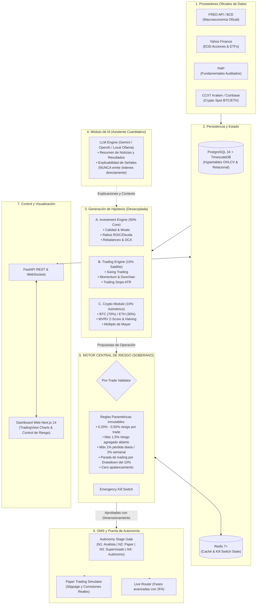

# ARQUITECTURA DEL SISTEMA
## AI Investment Intelligence & Portfolio Management System
**Versión**: 0.1.0 (Fase 1: Foundation)  
**Estado**: Activo (Modo Analista & Simulación)

---

## 1. Visión y Principios Rectores

El sistema está concebido como una plataforma institucional personal de gestión cuantitativa de patrimonio, no como un bot especulativo de alta frecuencia.

### Principios Fundamentales:
1. **Soberanía Absoluta del Motor de Riesgo**: El Risk Engine es independiente e inviolable. Ningún modelo probabilístico ni LLM puede saltarse los límites predefinidos de pérdida o tamaño de posición.
2. **Defensa en Profundidad y Aislamiento**: Separación estricta entre lectura y trading; prohibición absoluta de permisos de retirada (*withdrawal*) en claves de API.
3. **Desacoplamiento Funcional**: Los motores de inversión (Largo Plazo), trading (Táctico) y criptoactivos (BTC/ETH) emiten propuestas; el Risk Engine las valida y calcula el dimensionamiento; el OMS las enruta según el nivel de autonomía.
4. **Topología Híbrida de Infraestructura (PC + NAS + Cloud)**.

---

## 2. Topología de Infraestructura Hardware

El diseño del sistema distribuye las cargas de trabajo de forma óptima según las capacidades de cada equipo:

```mermaid
flowchart LR
    subgraph PC_LOCAL["PC Principal (AMD Ryzen 9 3950X / RTX 3090 / Win 11)"]
        DEV["Entorno de Desarrollo & Git"]
        BT_HEAVY["Backtesting Intensivo & Monte Carlo (VectorBT)"]
        GPU_AI["Entrenamiento & Modelos Locales (RTX 3090)"]
        RESEARCH["Investigación Cuantitativa & Jupyter"]
    end

    subgraph CLOUD_VPS["Cloud 24/7 (VPS Seguro Hetzner / Contenedores)"]
        FASTAPI["FastAPI Backend (Async Engine)"]
        SOVEREIGN_RISK["Sovereign Risk Engine & Circuit Breaker"]
        DB[("PostgreSQL 16 + TimescaleDB")]
        REDIS_CACHE[("Redis 7+")]
        WORKERS["Scheduled Data Collectors & OMS"]
        MONITOR["Alertas 24/7 & Telemetría"]
    end

    subgraph NAS_AUX["NAS Auxiliar (Synology DS218j - 512MB RAM)"]
        COLD_BACKUP["Copias de Seguridad Frías (DB Dumps)"]
        LOGS_ARCHIVE["Históricos de Logs Exportados"]
        DISASTER_REC["Recuperación ante Desastres"]
    end

    PC_LOCAL -->|Push Código & Modelos| CLOUD_VPS
    CLOUD_VPS -->|Sync Backups Diarios (rsync/sftp)| NAS_AUX
```

* **PC Principal (Ryzen 9 3950X, RTX 3090, 64GB+, Windows 11)**:
  * Desarrollo local con Docker Desktop / WSL2.
  * Backtesting multianual vectorial y simulaciones estocásticas de Monte Carlo con aceleración paralela CPU/GPU.
  * Inferencia y fine-tuning de modelos LLM locales (vía Ollama o PyTorch) para análisis de noticias y fundamentales.
  * *No se depende de que el PC esté encendido para la operativa continua 24/7.*
* **Servidor Cloud (VPS 24/7)**:
  * Entorno de producción continua.
  * Aloja el Backend FastAPI, el Risk Engine, el OMS supervisado, la base de datos principal y los colectores de mercado.
  * Funciona de forma ininterrumpida aunque el PC de casa, el router o el suministro eléctrico se desconecten.
* **NAS Auxiliar (Synology DS218j, 512 MB RAM)**:
  * *Uso exclusivamente pasivo y auxiliar*: Almacenamiento seguro de copias de seguridad de la base de datos, exportaciones de logs y configuración cifrada.
  * *Nunca aloja la base de datos de producción ni procesa lógica de trading*, respetando su limitada memoria RAM.

---

## 3. Diagrama de Arquitectura de Software



---

## 4. Descripción de Componentes del Sistema

### 4.1 Ingestion & Normalization (`src/data_engine/`)
* Ingestores modulares desacoplados mediante interfaces canónicas.
* Normalización de cotizaciones al esquema unificado `MarketDataOHLCV` en EUR.
* Detección automática de datos desactualizados o anomalías de volatilidad.

### 4.2 Motores Analíticos
* **Investment Engine (`src/investment_engine/`)**: Horizonte de meses/años. Screener fundamental cuantitativo (ROIC > 15%, Deuda neta/EBITDA < 2.5, márgenes estables), rebalanceo por bandas y DCA dinámico.
* **Trading Engine (`src/trading_engine/`)**: Horizonte de días a semanas (Swing/Momentum). Rupturas de Donchian, medias exponenciales (EMA 20/50/200), fuerza relativa y salidas dinámicas con ATR.
* **Crypto Intelligence Module (`src/crypto_module/`)**: Monitoreo 24/7 de Bitcoin y Ethereum. Análisis de ciclos de 4 años, Mayer Multiple y zonas de infravaloración por MVRV Z-Score.

### 4.3 Módulo de Inteligencia Artificial (Analista Cualitativo)
* Actúa como asistente de investigación y generador de informes.
* Procesa noticias, comunicados oficiales de resultados empresariales y resume el contexto macroeconómico.
* **Regla Inquebrantable**: El LLM no puede enviar órdenes al broker ni relajar parámetros de riesgo. Sus salidas son interpretadas exclusivamente como factores informativos.

### 4.4 Risk Engine (Motor Central Soberano)
* Interceptor obligatorio e independiente.
* Dimensionamiento matemático de cada orden:
  $$N = \left\lfloor \frac{\text{Capital} \times R_{\%}}{P_e - SL} \right\rfloor$$
* Circuit breakers duros (revisión al 8% de drawdown, parada total al 10%).
* Conmutador de parada de emergencia (*kill switch*) global en memoria Redis.

### 4.5 Capa de Ejecución y Puerta de Autonomía
* Control estricto de la etapa activa del sistema:
  * **Nivel 1 (Analista)**: Solo lectura y generación de hipótesis.
  * **Nivel 2 (Paper Trading)**: Ejecución simulada con spreads y comisiones reales.
  * **Nivel 3 (Supervisado)**: Propuesta con notificación y confirmación manual obligatoria 2FA.
  * **Nivel 4 (Autonomía Limitada)**: Ejecución automática exclusivamente bajo límites inmutables.
