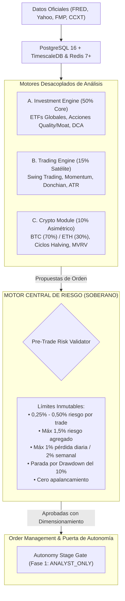

# AI Investment Intelligence & Portfolio Management Platform

Plataforma profesional e institucional de análisis cuantitativo multiactivo, asignación estratégica de capital, gestión soberana del riesgo y ejecución algorítmica supervisada.

---

## 🎯 Principio y Misión del Proyecto

Construir un gestor patrimonial cuantitativo personal serio, auditable y seguro, no un bot especulativo:
* **Preservación Estricta del Capital**: Prioridad absoluta en la gestión y control del riesgo frente a la optimización de rentabilidades hipotéticas.
* **Soberanía del Risk Engine**: El motor de riesgo matemático es independiente e inviolable. La IA y los modelos probabilísticos no tienen potestad para enviar órdenes a brokers ni alterar los límites de protección.
* **Topología de Infraestructura Óptima**:
  * **PC Principal (Ryzen 9 3950X / RTX 3090)**: Desarrollo, backtesting intensivo, simulaciones de Monte Carlo y modelos de IA locales.
  * **Cloud VPS**: Funcionamiento continuo 24/7 para el backend, telemetría y ejecución autorizada, independiente de cortes eléctricos en el hogar.
  * **NAS Synology DS218j**: Exclusivamente almacenamiento auxiliar de copias de seguridad frías y archivos históricos de logs.
* **Autonomía Progresiva en 4 Niveles**: Nivel 1 (Analista) → Nivel 2 (Paper Trading) → Nivel 3 (Supervisado con 2FA) → Nivel 4 (Autonomía Limitada).

---

## 🏗️ Motores de Inversión y Arquitectura



---

## 📁 Estructura del Repositorio

```
proyecto-ai-investment-intelligence-auto/
├── docs/                                # Documentación de diseño y guías operativas
│   ├── architecture/
│   │   ├── system_design.md             # Blueprint técnico maestro
│   │   ├── data_model.md                # Esquema DDL TimescaleDB / PostgreSQL
│   │   └── cloud_free_tier_analysis.md  # Comparativa de capas gratuitas Cloud
│   └── guides/
│       ├── windows11_setup.md           # Guía de instalación en PC local (Windows 11)
│       └── oci_always_free_deployment.md# Guía de despliegue 24/7 en Oracle Cloud (Coste 0€)
├── src/                                 # Código fuente de la plataforma
│   ├── core/                            # Configuración Pydantic, seguridad y DB async
│   │   ├── config.py
│   │   ├── database.py
│   │   ├── security.py
│   │   └── telemetry.py
│   ├── models/                          # Modelos ORM SQLAlchemy 2.0
│   │   ├── base.py
│   │   ├── asset.py
│   │   ├── market_data.py
│   │   ├── portfolio.py
│   │   ├── signal.py
│   │   ├── risk.py
│   │   └── audit.py
│   ├── services/                        # Lógica de negocio y cálculo cuantitativo
│   │   ├── portfolio_service.py         # Asignación de compartimentos de capital
│   │   └── risk_service.py              # Motor soberano de riesgo y position sizing
│   └── api/                             # API REST FastAPI
│       ├── main.py                      # App entrypoint y lifespans
│       └── v1/
│           ├── api.py                   # Enrutador maestro
│           └── endpoints/               # Endpoints REST (/health, /assets, /portfolio, /risk, /signals)
├── tests/                               # Suite de tests automatizados con Pytest
│   ├── conftest.py
│   ├── test_config.py
│   ├── test_health.py
│   ├── test_portfolio_allocations.py
│   └── test_risk_engine.py
├── ARCHITECTURE.md                      # Arquitectura detallada y topología de hardware
├── ROADMAP.md                           # Hoja de ruta de 10 fases y sprints
├── CHANGELOG.md                         # Historial de versiones y cambios
├── DECISIONS.md                         # Registro de decisiones de arquitectura (ADR)
├── SECURITY.md                          # Política de seguridad y aislamiento de claves
├── docker-compose.yml                   # Orquestación TimescaleDB, Redis y Backend
├── Dockerfile                           # Contenedor de backend en Python 3.12
├── requirements.txt                     # Dependencias de producción
├── requirements-dev.txt                 # Dependencias de testing y desarrollo
└── pyproject.toml                       # Metadatos del proyecto y configuración Pytest
```

---

## 🚀 Puesta en Marcha en Windows 11 (PC Principal)

> Consulta la guía detallada en [docs/guides/windows11_setup.md](docs/guides/windows11_setup.md).

### Con Docker Compose (Recomendado):
```powershell
# 1. Copiar configuración de entorno
Copy-Item .env.example .env

# 2. Levantar servicios
docker compose up --build
```
* **Documentación Interactiva (Swagger)**: [http://localhost:8000/docs](http://localhost:8000/docs)
* **Healthcheck**: [http://localhost:8000/api/v1/health](http://localhost:8000/api/v1/health)
* **Desglose de Asignación de Capital**: [http://localhost:8000/api/v1/portfolio/allocation](http://localhost:8000/api/v1/portfolio/allocation)

### Con Entorno Virtual Local de Python:
```powershell
python -m venv .venv
.\.venv\Scripts\Activate.ps1
pip install --upgrade pip
pip install -r requirements-dev.txt
pytest -v
uvicorn src.api.main:app --reload --port 8000
```

---

## 🛡️ Estado Actual: Fase 1 (Foundation) — Modo Analista

* **Autonomía Activa**: `ANALYST_ONLY` (Etapa 1).
* **Capacidad de Trading Real**: **Deshabilitada por diseño**.
* **Tests Automatizados**: 14/14 tests pasando exitosamente.
